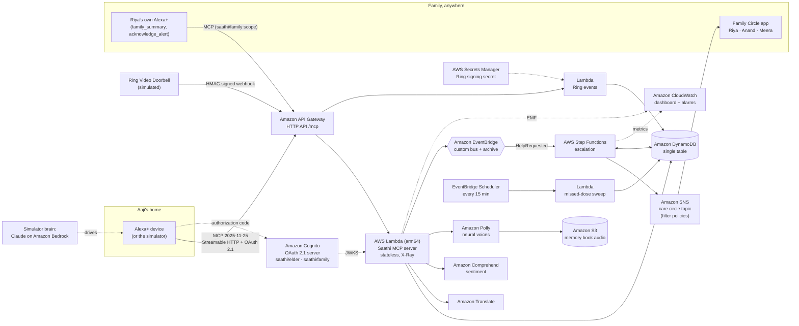

# Saathi (साथी) - a companion on Alexa+ for elders, and the families who love them

> *Saathi* means "companion" in Hindi and Marathi.

Kamala is 78. Everyone calls her **Aaji**. She lives alone in Pune, speaks Marathi, has early-stage Alzheimer's and doesn't hear as well as she used to. Her granddaughter **Riya** is in Toronto and grew up speaking English. They love each other, but they share less and less language, and Riya worries every day she doesn't hear from her.

**Saathi is an Alexa+ integration (a self-hosted MCP server, spec 2025-11-25, Streamable HTTP) that closes that gap.** Aaji talks to Alexa the way she talks to anyone, in her own language and at her own pace. Saathi:

- **Orients her gently.** "What day is it?" and "Who is Riya?" get patient answers. She is never quizzed or corrected. Memory support is built into the tools, not added on top.
- **Keeps her tablets straight.** Each tablet is described by colour and purpose ("the small white round one, for blood pressure"), and a second dose is refused if she already took it today.
- **Listens to how she feels.** Every check-in runs through sentiment analysis plus a multilingual safety screen. Loneliness sends the family a **gentle nudge, not an alarm**: *"Aaji said she feels lonely today; a voice note from you would mean a lot."*
- **Calls for help when it matters.** If she mentions a fall, chest pain, breathlessness or being lost, a **Step Functions escalation** starts. Her family hears first. If nobody responds, her neighbour Meera is asked to check on her. If still nobody responds, everyone gets emergency guidance. As soon as anyone taps *"I'm on it"*, the escalation stops and Aaji hears that someone is coming.
- **Translates in both directions.** Riya writes in English and Aaji hears it in Marathi. Aaji replies in Marathi, and Riya reads it in English while her uncle Anand reads it in Hindi.
- **Keeps her stories in a memory book.** The stories she tells Alexa are saved in her words, translated into every family language and narrated with Amazon Polly, so a granddaughter who can't read Marathi can still hear her grandmother's childhood.
- **Watches the front door with a Ring doorbell.** A ring after the neighbour has been sent for closes the emergency: help has physically arrived. A morning with no door activity, no check-in and no tablets earns the family one gentle "a quick call would be kind".
- **Respects her choices.** She can say *"keep this between us"* and ordinary sadness stays private. Danger always overrides privacy. Nothing she says leaves the house until she confirms *"yes, send it"*.

Inclusion runs through the whole design, not a single feature. Saathi is built for people with memory loss, hearing loss or low vision, for people who don't read well, for people who speak a language voice assistants rarely support, and for families spread across continents.

---

## What's in this repository

| Piece | What it is | Where |
|---|---|---|
| **Saathi MCP server** | 12 tools, 3 resources, 2 prompts. Streamable HTTP, protocol `2025-11-25`, bearer-token auth | `src/mcp/server.js`, `src/http/mcpRoute.js` |
| **Serverless deployment** | The same server as a stateless AWS Lambda behind API Gateway | `src/lambda/mcp.js` |
| **Simulated Alexa+ device** | Echo Show-style web app. It is a real MCP client: Claude (on Amazon Bedrock or the Claude API) decides which tools to call. Voice in and out, 8 languages, large text, high contrast, slower speech | `public/index.html`, `src/agent/` |
| **Family Circle app** | Live dashboard for Riya, Anand and Meera, each in their own language. Alerts with escalation progress, mood timeline, memory book, translated messages | `public/family.html` |
| **Escalation workflow** | One Amazon States Language definition. It is deployed to AWS Step Functions **and** executed offline by a built-in ASL interpreter | `src/escalation/` |
| **Infrastructure as code** | AWS CDK stack: 58 resources across 15 AWS services | `infra/` |
| **Ring doorbell integration** | HMAC-signed, replay-protected webhook (`/ring/events`), a simulated Ring Video Doorbell, and its own Lambda in AWS | `src/ring/`, `src/lambda/ring.js` |
| **OAuth 2.1 authorization** | Per the MCP authorization spec: Amazon Cognito is the authorization server, Saathi the protected resource (RFC 9728 metadata), with `saathi/elder` and `saathi/family` scopes | `src/auth/` |
| **Safety and routing evals** | 44 multilingual safety cases (100% emergency recall, zero false alarms required) and 25 routing cases | `evals/` |
| **Spoken in her language, offline** | Every reply Saathi speaks is written in Marathi, Hindi and English, with her routine, tablets and family described in each. Aaji hears Marathi even with no translation service or model | `src/domain/i18n.js` |
| **Accessibility audit** | axe-core in a real browser across 5 page states (default, high contrast, confirmation dialog, family app, phone width): 0 violations, enforced in CI | `scripts/a11y.js` |
| **Deployment smoke test** | One command checks a live endpoint: OAuth token, RFC 9728 metadata, 401 without a token, protocol 2025-11-25, tools, a Marathi reply, scopes | `scripts/smoke.js` |
| **Tests** | 43 server tests (MCP protocol features, OAuth, Ring, dignity, retry safety, localisation, translation cache, Lambda, escalation, AWS SDK mocks, evals) and 8 CDK assertion tests | `test/`, `infra/test/` |

## Architecture



**AWS services used in code:** Amazon Bedrock, Amazon Translate, Amazon Comprehend, Amazon Polly, Amazon DynamoDB, Amazon S3, Amazon EventBridge (bus, archive and Scheduler), AWS Step Functions, Amazon SNS, Amazon Cognito, AWS Lambda, Amazon API Gateway, AWS Secrets Manager, Amazon CloudWatch (EMF metrics, dashboard, alarms), AWS X-Ray, and AWS CDK for all of it. Plus a Ring doorbell integration.

A deeper tour, with sequence diagrams for escalation, elicitation and OAuth, is in [docs/ARCHITECTURE.md](docs/ARCHITECTURE.md).

Every AWS integration sits behind a small adapter and has an offline stand-in: a JSON-file store, an in-process event bus, the local ASL interpreter, a lexicon-based sentiment model and the browser's own voice. So **the whole project runs with `npm start` and no cloud account**, and each service can be switched to AWS on its own. Adapter code is in `src/aws/` and `src/local/`, and the wiring is in `src/services.js`.

### Design decisions worth calling out

- **One escalation definition, two runtimes.** `src/escalation/escalation.asl.json` is deployed verbatim to Step Functions (`infra/lib/saathi-stack.js`). `src/escalation/interpreter.js` runs the same JSON locally, with the SNS and DynamoDB service integrations mapped to local adapters. The tests run the real workflow logic, not a mock of it.
- **Comprehend doesn't do Marathi sentiment, so Saathi translates first.** Languages DetectSentiment doesn't support are routed through Amazon Translate to English before analysis (`src/aws/language.js`).
- **Safety doesn't depend on sentiment scores.** A multilingual phrase screen (English, Hindi, Marathi, romanised forms) runs on every check-in, so "मी पडले" ("I fell") always escalates. It also avoids false alarms like "blood pressure tablet" (`src/domain/safety.js`).
- **Nudge, don't alarm.** Low mood or loneliness notifies family gently, with no escalation. Real alerts are kept for real danger, so families don't start ignoring them.
- **Stateless on Lambda, stateful locally.** The Lambda transport runs in stateless JSON-response mode, so it scales horizontally with no sticky sessions. The local Express server keeps per-client sessions and SSE streams.
- **An elder should never hear an error.** If the model is rate-limited or unavailable, the simulator falls back to the offline planner for that turn.
- **Exactly one escalation per emergency.** Alexa+ may retry a tool call, and a frightened person asks twice. Help requests and urgent check-ins join an open alert instead of starting a second workflow (`openHelpAlert` in `src/domain/saathi.js`).
- **Measured safety.** The phrase screen is scored by `npm run eval` against multilingual cases. That eval found real bugs: "prices have fallen" and Hindi "leaves are falling" raised false alarms, and romanised "seene mein dard" (chest pain) was missed. Falls are now matched in the first person, and CI fails if recall drops below 100%.
- **Her language is the default, not an add-on.** Spoken replies are authored in Marathi, Hindi and English (`src/domain/i18n.js`), with Devanagari numerals in Marathi, so the voice never mixes scripts mid-sentence. Translation services are only needed for what people write to each other, and each message is translated once per language and cached.
- **A ring at the door is evidence, not proof.** It only closes an emergency once the neighbour has been sent for. Before that it could be a delivery, so the family is told but the workflow keeps going.

---

## Run it locally (2 minutes, no cloud account)

Requires Node.js 20 or later.

```bash
npm install
npm start
```

Then open:

- **Aaji's Alexa+ simulator**: http://127.0.0.1:8787/
- **Family Circle app**: http://127.0.0.1:8787/family.html (open it side by side)
- **MCP endpoint**: `http://127.0.0.1:8787/mcp`

Try tapping **💛 माझं मन** ("how I feel") in Marathi and watch the family app get a gentle nudge. Then tap **🆘 मदत** ("help") and watch the escalation move from family to neighbour to emergency, and stop the moment you press *"I'm on it"*.

With no model configured, an offline rule-based planner stands in for Alexa+. It still replies in Marathi, Hindi or English, because every spoken line is localised in the server itself. Add a Claude key for free-form conversation and translation of anything family members write:

```bash
ANTHROPIC_API_KEY=sk-ant-... npm start          # Claude API
SAATHI_USE_BEDROCK=true AWS_REGION=us-east-1 npm start   # Claude on Amazon Bedrock
```

With a model, Claude also stands in for Amazon Translate when Translate is off, so messages and stories are translated even without AWS.

### Inspect the MCP server directly

```bash
npm run inspect      # MCP Inspector; connect to http://127.0.0.1:8787/mcp (Streamable HTTP)
```

### Tests, evals and audits

```bash
npm test                    # 43 tests: MCP protocol features, OAuth, Ring, dignity, retry safety, localisation, Lambda, escalation, AWS adapters
npm run eval                # multilingual safety + routing evals with a per-language report
npm run a11y                # axe-core accessibility audit in Chromium (CHROME_PATH=... to pick a browser)
cd infra && npm install && npm test   # 8 CDK assertion tests
```

CI runs all four on every push.

### Authentication modes

| `SAATHI_AUTH_MODE` | Use | How |
|---|---|---|
| `none` (default locally) | Development | No `Authorization` header |
| `static` | Demos through a tunnel | `SAATHI_MCP_TOKEN` (all scopes) and optionally `SAATHI_FAMILY_TOKEN` (family scope only) |
| `cognito` (default on AWS) | Production | Cognito access tokens (JWT) verified against the pool's JWKS. `/.well-known/oauth-protected-resource/mcp` advertises the authorization server, and a 401 carries `WWW-Authenticate: Bearer resource_metadata=...` |

---

## Deploy to AWS

```bash
cd infra
npm install
npx cdk bootstrap                       # once per account/region
npx cdk deploy \
  -c familyEmails=riya@example.com,anand@example.com \
  -c neighbourEmails=meera@example.com \
  -c opsEmail=you@example.com
```

The stack outputs `McpEndpoint` (register this with Alexa+), the Cognito `OAuthIssuer`, `OAuthDomain` and client IDs, and `RingWebhookUrl` with its `RingWebhookSecretArn`. To smoke-test with a machine token:

```bash
curl -s -u "<ServiceClientId>:<client secret>" -d grant_type=client_credentials -d scope=saathi/elder \
  "<OAuthDomain>/oauth2/token"
```

Pass `-c oauthCallbackUrls=<Alexa+ redirect URI>` so the elder and family device clients can complete the authorization code flow.

Then check the live deployment end to end:

```bash
SAATHI_URL=<McpEndpoint> SAATHI_OAUTH_DOMAIN=<OAuthDomain> \
SAATHI_CLIENT_ID=<ServiceClientId> SAATHI_CLIENT_SECRET=<secret> npm run smoke
```

Seed the demo household and point the simulator and family app at the deployed resources:

```bash
export AWS_REGION=us-east-1 SAATHI_USE_AWS=true SAATHI_USE_BEDROCK=true \
  SAATHI_TABLE=... SAATHI_EVENT_BUS=... SAATHI_FAMILY_TOPIC_ARN=... \
  SAATHI_MEDIA_BUCKET=... SAATHI_ESCALATION_SFN_ARN=...
npm run seed:aws
npm start
```

Prerequisites: Amazon Bedrock model access for Claude in your region. Family members confirm their SNS email subscriptions.

### Connecting a real Alexa+ device

Register the `McpEndpoint` URL as a remote MCP server in your Alexa+ Preview integration, with the Cognito authorization server (or a static bearer token). To use a laptop instead of Lambda, run with `HOST=0.0.0.0 SAATHI_MCP_TOKEN=... SAATHI_ALLOWED_HOSTS=<tunnel host>` behind an HTTPS tunnel.

---

## MCP surface

| Tool | For | What it does |
|---|---|---|
| `what_day_is_it` | Aaji | Day, date, time, where she is, what's next in her routine |
| `who_is` | Aaji | Who someone is, by name or relationship in English/Hindi/Marathi, with their last message |
| `get_medication_schedule` | Aaji | Today's tablets by colour, purpose and status |
| `confirm_medication_taken` | Aaji | Records a dose and refuses a double dose |
| `daily_check_in` | Aaji | Sentiment plus safety screen; nudges family or escalates |
| `ask_family_for_help` | Aaji | Starts the escalation workflow |
| `get_family_messages` | Aaji | Messages from family, translated into her language |
| `send_message_to_family` | Aaji | Sends her words, translated per recipient |
| `save_memory_story` | Aaji | Memory book entry, translated and narrated |
| `list_memory_stories` | Aaji | Retell her stories |
| `family_summary` | Family | "How is Aaji today?" in the asker's language |
| `acknowledge_alert` | Family | "I'm on it": stops escalation and reassures her |

**Resources:** `saathi://elder/profile` (accessibility needs that shape how Alexa+ speaks), `saathi://circle`, `saathi://today` (subscribable), and the template `saathi://stories/{storyId}`.
**Prompts:** `gentle_morning_check_in`, `memory_lane` (with argument completion).
The server also sends `instructions` on initialize: short, warm sentences, never quiz her memory, follow her language.

### MCP spec coverage (2025-11-25)

| Feature | How Saathi uses it |
|---|---|
| Streamable HTTP | Stateful sessions with SSE locally; stateless JSON mode on Lambda |
| Authorization (OAuth 2.1, RFC 9728) | Cognito authorization server, protected resource metadata, scope-gated tools |
| Tool annotations | `readOnlyHint`, `idempotentHint`, `destructiveHint`, `openWorldHint` on every tool |
| Structured output | `outputSchema` on 5 tools; `structuredContent` validated against it |
| Elicitation (form) | "Shall I send this to Riya?" before any message leaves the house, with big yes/no buttons on the device |
| Progress notifications | Story translation and narration report each step |
| Resource subscriptions | `saathi://today` pushes `notifications/resources/updated` on tablets, check-ins, alerts and door activity |
| `resources/list_changed` | Sent when a new story joins the memory book |
| Resource templates and completions | `saathi://stories/{storyId}` with ID completion; `memory_lane` theme completion |
| Logging | Escalation steps stream to the client as `notifications/message` |
| Server instructions | Persona and safety guidance for Alexa+ |

## Accessibility

- Voice first, with captions always on screen
- Atkinson Hyperlegible typeface (designed for low-vision readers), a large-text mode and a high-contrast black/white/yellow mode
- Slower speech with SSML prosody, respects `prefers-reduced-motion`, keyboard-navigable with visible focus, `aria-live` captions
- Eight languages: English, Hindi, Marathi, Tamil, Bengali, Spanish, French and Arabic. Polly neural voices where they exist, the browser's voice otherwise
- Works on a phone (the family app is what Riya actually opens)

## Honest limitations

- **This is not a medical device.** Saathi supports care and doesn't replace it. Emergency guidance points to 112 (India).
- The Marathi and Hindi replies were written without a native-speaker review; have someone who speaks them read `src/domain/i18n.js` and `src/domain/seed.js` before a real deployment.
- Polly has no Marathi or Tamil voice. Marathi falls back to the Hindi voice (Kajal) and Tamil to the browser's voice.
- The offline sentiment model is a small lexicon. Use Comprehend for real deployments.
- The safety eval cases were written by the same team as the phrase screen. Real-world phrasing needs clinician- and family-sourced cases before anyone relies on it.
- The Ring doorbell is simulated. The webhook accepts Ring-style event payloads, but no Ring account or device was connected during the hackathon.
- The demo household is one family. Multi-household tenancy, authentication for the family app and consent flows are the next step.

## License

MIT. See [LICENSE](LICENSE).
