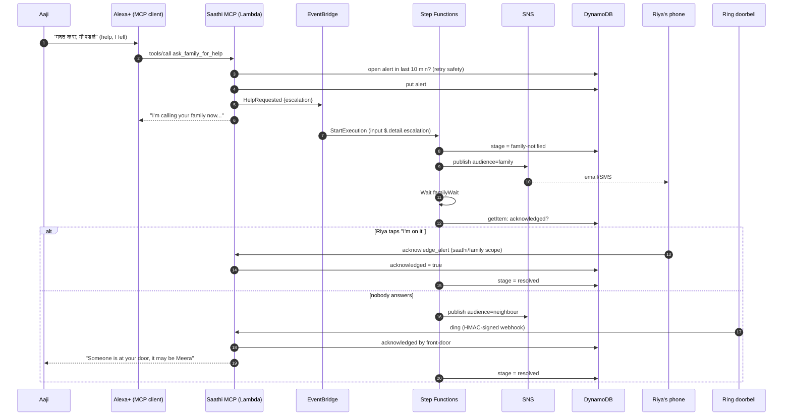
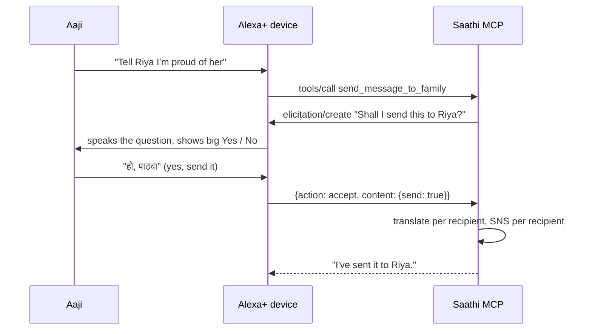

# Saathi architecture

## Layers

```
src/
  domain/        what Saathi does: orientation, tablets, check-ins, escalation, messages, stories, Ring signals
  mcp/           the MCP surface: tools, resources, templates, prompts, subscriptions, logging
  auth/          OAuth 2.1 resource server: static tokens or Amazon Cognito JWTs, per-tool scopes
  http/          Express: stateful Streamable HTTP, Ring webhook, simulator and family APIs, SSE
  lambda/        AWS entry points: stateless MCP, Ring events, scheduled sweeps
  escalation/    one ASL definition + a local interpreter for it
  aws/ local/    an adapter per capability, AWS-backed or offline
  agent/         the simulated Alexa+ device: MCP client + Claude (Bedrock or API) or offline planner
  ring/          webhook signing/verification and the simulated doorbell
evals/           multilingual safety and routing evals
infra/           AWS CDK
```

The domain never imports an AWS SDK. `src/services.js` picks an adapter for each capability from config flags, so every AWS service can be switched on independently and the tests run fully offline.

## A fall, end to end



## Elicitation: nothing leaves the house by accident



Elicitation needs a server-to-client channel, so it runs on the stateful transport. On stateless Lambda the client doesn't get elicitation, and the tool sends directly, as before.

## OAuth 2.1 (MCP authorization spec)

```mermaid
sequenceDiagram
  participant Client as Alexa+ / MCP client
  participant MCP as Saathi (protected resource)
  participant Cognito as Amazon Cognito (authorization server)
  Client->>MCP: POST /mcp (no token)
  MCP-->>Client: 401 WWW-Authenticate: Bearer resource_metadata=".../.well-known/oauth-protected-resource/mcp"
  Client->>MCP: GET /.well-known/oauth-protected-resource/mcp
  MCP-->>Client: {authorization_servers: [Cognito issuer], scopes_supported: [saathi/elder, saathi/family]}
  Client->>Cognito: authorization code + PKCE (scope saathi/elder)
  Cognito-->>Client: access token (JWT)
  Client->>MCP: POST /mcp, Authorization: Bearer <jwt>
  MCP->>MCP: verify signature (JWKS), issuer, token_use=access, client_id, scopes
  MCP-->>Client: tools; family-only devices get "needs saathi/elder" on elder tools
```

## Why each AWS service is there

| Service | Job | Why this and not something simpler |
|---|---|---|
| API Gateway (HTTP API) | Public `/mcp`, `/ring/events`, OAuth metadata | Throttling, TLS, routes to separate Lambdas |
| Lambda (arm64) | MCP server, Ring events, sweeps | Stateless Streamable HTTP scales to zero and out |
| Cognito | OAuth 2.1 authorization server | MCP's auth spec needs a real AS; scopes separate elder and family devices |
| DynamoDB | All household state | Single table; Step Functions reads and writes it directly |
| Step Functions | Escalation | Waits of minutes, retries, a visual audit of every emergency; no glue Lambdas |
| EventBridge | Care-event bus, archive, Scheduler | Decouples tools from workflows; the archive replays a year of care events |
| SNS | Family, neighbour and ops notifications | Filter policies: neighbours never see day-to-day nudges |
| Translate | Every message, story and check-in | Auto-detects Marathi vs Hindi |
| Comprehend | Check-in sentiment | Marathi is routed through Translate first |
| Polly | Narration and replies | Neural voices, slowed SSML prosody for hearing loss |
| S3 | Story narrations | Intelligent-Tiering, since memories are kept for years |
| Bedrock | Claude as the simulated Alexa+ brain | Same Messages API as the Claude API |
| Secrets Manager | Ring webhook signing secret | Rotatable, never in code or env |
| CloudWatch, X-Ray | Metrics (EMF), dashboard, alarms, traces | An alarm fires if an escalation ever fails |
